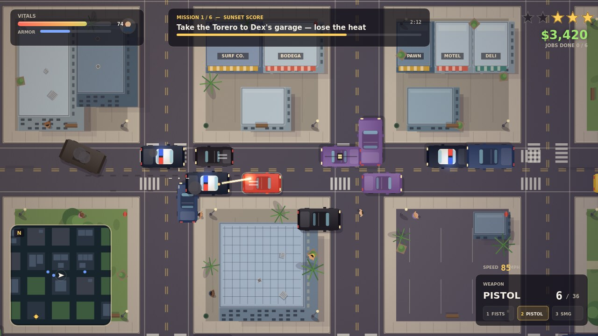

# VICE HARBOR

A complete open-world crime game in the spirit of GTA, built for make.fun's “Make GTA 6” bounty (gta6-01). It runs offline in a desktop browser from plain static files: a top-down sunset city of sixteen blocks, on foot and behind the wheel.



## What is in the city

- **A whole city, not a level:** sixteen blocks of downtown, Calle Ocho, motels, bodegas, a marina, a beach and a pier, with traffic, pedestrians, palm trees and a sunset shoreline.
- **On foot and by car:** walk, sprint, carjack, drive with a handbrake, and watch the car take damage. A minimap, speedometer and radio ride along.
- **A wanted level and police:** crimes raise the heat from one to five stars; cruisers spawn, sirens close in, officers deploy and give chase, and the stars cool off when you disappear. Get caught and you are BUSTED; go down and you wake up at Mercy General.
- **Combat:** fists, a pistol and an SMG, with muzzle flashes, tracers, impacts, blood, explosions, smoke and bodies that stay down.
- **A six-job story from Dex:** steal the cherry Torero, shake down three debtors, lose a two-star tail, survive a double-cross at the pier, wipe out a cartel crew, and finish it at the Mendez mansion.
- **A start screen and a save:** continue from `localStorage`, autosave, pause screen with stats, mixtapes to find, spray shops and hospitals.

## Controls

| Input | Action |
| --- | --- |
| `WASD` | walk / drive / steer |
| Mouse | aim; left click to shoot |
| `E` | get in / out of a car, interact, start a job, advance dialogue |
| `Shift` | sprint |
| `Space` | handbrake in a car; advance dialogue |
| `1` `2` `3` | fists / pistol / SMG |
| `R` | reload |
| `P` / `Esc` | pause |
| `M` | mute sound |
| `Enter` / `Space` | start, continue, get up from WASTED/BUSTED |

## Run it

```sh
node serve.ts
# open http://localhost:8080
```

Hand in the entry (the same program the grader runs):

```sh
mkdir -p out && MAKEFUN_OUTPUT_DIR=out node main.ts
```

`main.ts` copies `game/` and `screenshots/` to the output directory and writes `dossier.json`. The game itself loads nothing from the network: no libraries, fonts, images or data leave the folder.

## Screenshots

The four images in `screenshots/` are real 1280×720 browser renders, staged by the game's `?shot=` mode and captured with Playwright:

1. `1-cover.jpg` — a three-star chase through downtown: Torero, cruisers, traffic, mission HUD.
2. `2-marina.jpg` — on foot at the marina: the cherry Torero, a patrol cruiser, the beach crowd and the pier.
3. `3-pier.jpg` — a pier firefight: SMG tracers, Vic's crew, dialogue, wanted level and minimap.
4. `4-title.jpg` — the title screen with a saved game and the field manual.

## Under the hood

`game/src/` is a small set of ES modules with no dependencies: `city.js` builds the blocks and roads, `world.js` owns the player, wanted level and pickups, `cars.js` and `people.js` run the traffic, crowds and police, `combat.js` the bullets and effects, `missions.js` the six-job story, `render.js` the canvas world, `hud.js` the interface, `screens.js` the title/pause/end cards, `audio.js` a Web Audio soundtrack and `main.js` the fixed-step loop. The staged scenes used for the screenshots live in `shots.js`.

## License

MIT — see [LICENSE](LICENSE).
